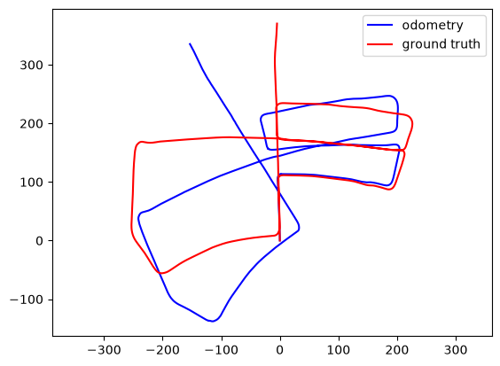

# CSC 4888: Computer Vision
## Homework 4: Visual Odometry
### Instructor: Jonathan Ventura

In this homework you will implement a visual odometry system to track the motion of a car.  You will use video from the stereo camera mounted on the car. 

The video comes from the [KITTI dataset](https://www.cvlibs.net/datasets/kitti/), a classic self-driving car dataset that provides stereo video as well as ground truth camera calibration and poses.  We will use sequence 05 from the [odometry / SLAM dataset](https://www.cvlibs.net/datasets/kitti/eval_odometry.php).

The [`pykitti`](https://github.com/utiasSTARS/pykitti) Python package provides a convenient wrapper for the KITTI dataset.  The provided starter notebook shows how to load the data for sequence 05.

Because scikit-image's pure Python implementation of feature extractors is slow, we will instead use the ORB extractor implemented in OpenCV.  The starter notebook provides example functions to extract and match ORB keypoints.

The stereo visual odometry system will estimate the $4\times4$ camera-to-world transformation matrix $T_t^0$ for the left camera at each timestep $t$.  The first transformation matrix is $T_0^0=I$ (the identity matrix).

The concept of the stereo visual odometry system is to use the stereo pair at time $t$ to triangulate 3D points, and then estimate the pose of the camera at time $t+1$ based on observations of those 3D points.

Here is a description of the algorithm:

For each timestep $t$:
1. Match keypoints from the left image to the right image at timestep $t$.
2. Reject any matches that don't satisfy the epipolar constraint.
3. Triangulate 3D points (`cv2.triangulatePoints`) using the accepted matches.
4. If $t=0$, stop here and continue to the next loop iteration.
5. Match triangulated keypoints in the left camera at timestep $t-1$ to keypoints in the left camera at timestep $t$.  Since each triangulated keypoint has an associated 3D point, you now have a matching between 3D points at timestep $t-1$ and 2D keypoints at timestep $t$.
6. Use these 3D-2D matches in PnP RANSAC (`cv2.solvePnPRansac`) with an inliers threshold of 2 pixels.  The result is the transformation $T_{t-1}^{t}$.
7. Invert this transformation (`np.linalg.inv`) to get $T_{t}^{t-1}$.
7. Compose the current transformation with the previous transformation (`np.matmul`) to obtain the pose of the current camera with respect to the first camera: $T_{t}^{0}=T_{t-1}^{0}T_{t}^{t-1}$.

## Code requirements

#### 
1. Implement the visual odometry system as described above.
2. Plot the X-Z coordinates of the camera centers estimated by your VO system and from the ground truth.  Your plot should look like this:

## Report

Provide a short explanation of your solution.  Be sure to document any sources you used in preparing your code, including websites and AI tools.

#### Discussion questions

1. The error in the VO estimate increases over time -- this is called "drift."  Why does it occur?
2. Describe some ideas for how to reduce drift in the VO estimate.

## Submission instructions

Submit your Python notebook (.ipynb file) (be sure to "run all" before submitting) and report (PDF or docx).  Please do not put them in a zip file, just submit the files directly.